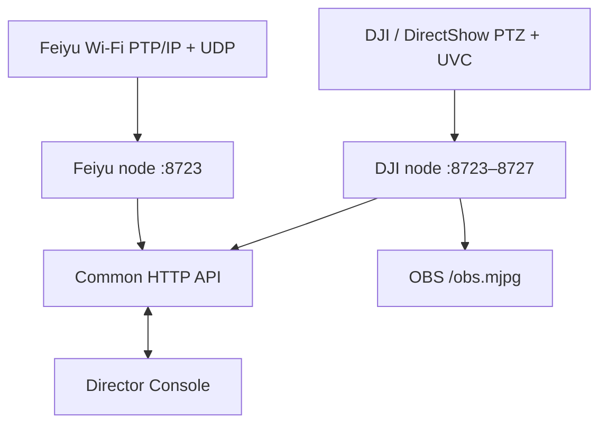

# Architecture

## Components

- `ptz-server.py`: one node per physical camera. Owns DirectShow PTZ and on-demand UVC capture.
- `feiyu-server.py` and `feiyu_protocol.py`: experimental Feiyu control node. Maintains the PTP/IP heartbeat and sends CRC-protected pan/tilt velocity packets over UDP.
- `multi-ptz-launcher.py`: discovers cameras, assigns ports, launches hidden nodes, displays consolidated status, and stops children on exit.
- `director-console.py`: local wrapper for the director UI and preview receivers.
- `director-panel.html`: three-channel control surface and scene macro UI.
- `ndi_preview.py`: NDI/Direct UVC preview plus software tracking.

## Video ownership

Windows UVC devices are often single-client. The node therefore owns the camera once and fans encoded frames out to the director preview and OBS clients. OBS should consume `/obs.mjpg`, not open the same camera as a Video Capture Device.

The Feiyu backend intentionally does not own video. The Director uses a separately selected NDI source, while the HTTP node controls motion only.

## Isolation

Each camera runs in a separate process and configuration file. A failure or unsupported video mode on one device should not change another device's capture mode. The launcher passes its PID to every node so hidden children exit when the launcher closes.

## Network boundary

Nodes bind to `0.0.0.0` for LAN access. There is currently no authentication or TLS. Use only on a trusted LAN or isolate the ports with firewall/VLAN rules. Never expose `8723–8727` directly to the public Internet.
